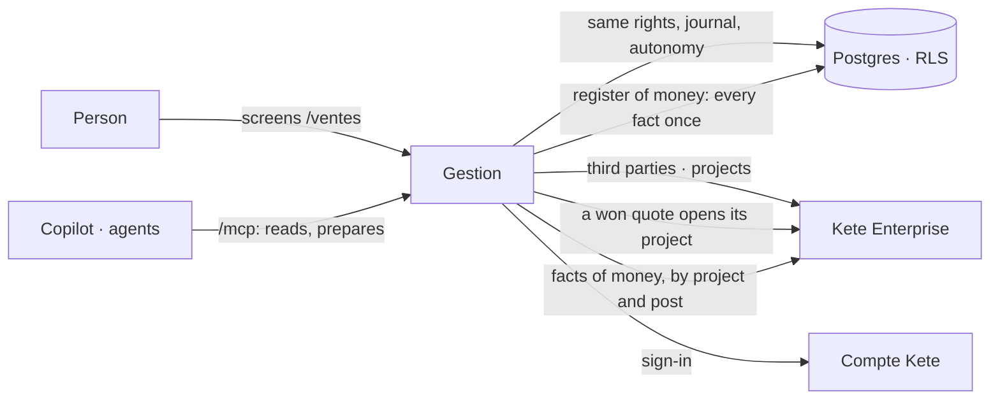

# Kete Gestion

The money of a company, in one register: **sales** (quotes, invoices, money received),
**purchases and expenses**, **treasury**. One app, three parts — because a franc invoiced, a franc
committed and a franc in the bank are the same franc seen at three moments.

Gestion is one of the four apps behind the center, Kete Enterprise (doctrine D-048). It keeps no
client file and no project of its own: third parties and projects are the center's references
(D-047), and every fact of money carries its project — or counts in the running of the
organization (D-049). Kete executes no payment and keeps no general ledger: Gestion says what is
invoiced, received, committed and spent, with the proof of each gesture.



## Where it stands

`docs/ROADMAP.md` says what is built and what is proven, step by step.

| Part                   | State                                                                   |
| ---------------------- | ----------------------------------------------------------------------- |
| Sales                  | Built (spec 001): quotes, invoices, receipts, a won quote's project     |
| Purchases and expenses | Built (spec 002): requests by project and post, expense notes, advances |
| Treasury               | Next (step G3)                                                          |

## Run locally

```bash
# Once per machine: a GitHub token with read:packages, kept in your user configuration.
pnpm config set "//npm.pkg.github.com/:_authToken" <token>
pnpm install
cp .env.example .env   # then fill it: database, Compte Kete registration, session secret
pnpm db:migrate
pnpm dev               # http://localhost:3400
pnpm worker            # in another terminal: e-mails and events
```

To look at the screens without a Compte Kete nor a center:

```bash
pnpm demo              # http://localhost:3411 — a small company at work, in a throwaway schema
```

`pnpm demo` needs only the two test addresses of `.env` (`KETE_TEST_OWNER_URL`,
`KETE_TEST_APP_URL`). It opens as the owner; `http://localhost:3411/sales`, `/buyer`, `/accountant`
and `/cashier` open as the roles of the trade. It runs without a center: no project there, every
expense is the running of the organization, decided by the owner.

## Test

```bash
pnpm test              # a Neon "test" branch, or KETE_TEST_POSTGRES=container
pnpm typecheck
```

## Settings

| Variable              | What it sets                                                          |
| --------------------- | --------------------------------------------------------------------- |
| `ENTERPRISE_API_URL`  | The center. Without it the app works alone: no project, no reference  |
| `GESTION_CURRENCY`    | The currency of new documents (ISO 4217); `XOF` by default            |

## Deploy

The repository's secret `KETE_PACKAGES_TOKEN` (read:packages) lets CI read kete-core's packages;
the image receives it as the build secret `node_auth_token`. One image, two roles (doctrine
ARCHITECTURE_APP §9): the web process (`pnpm start`, migrations at start-up) and the worker
(`pnpm worker`). An operator registers the app at the Compte Kete (client id and secret), declares
it in Kete Cockpit (its events key) and in the organization's Kete Enterprise (its manifest).
