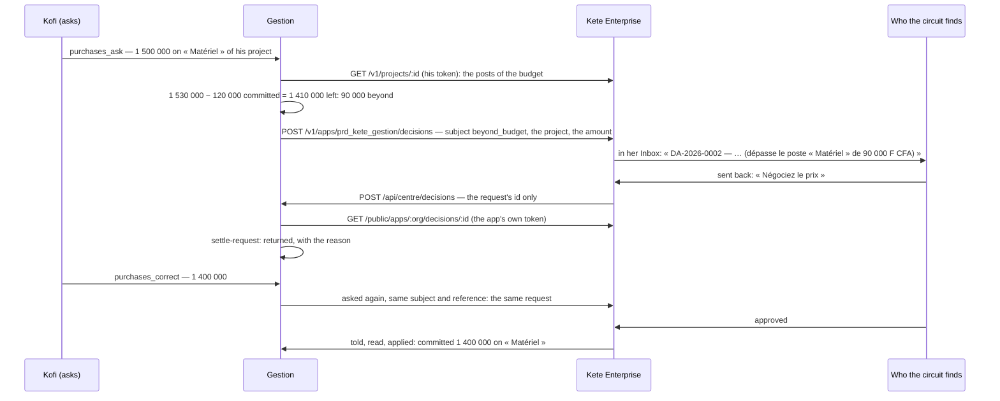

# A request beyond its post goes up the circuit

- The standing of a request is computed in the transaction that writes it; the decision is asked
  after it commits, with the token of who asked.
- Without a circuit for `beyond_budget` the ordinary one decides; without any, or without a
  center, who holds `purchases:approve` decides here — never who asked.
- The center's message carries no decision: the app reads it, as itself.
