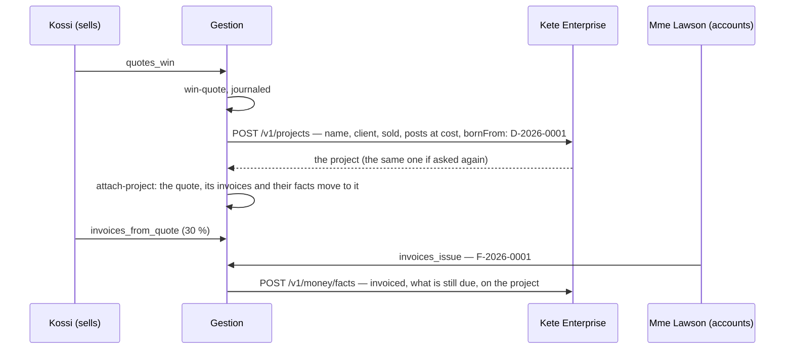

# A won quote opens its project

- The center is asked **after** the gesture commits, with the token of who acted: it answers
  within her rights. If it refuses her or is away, the quote stays won and its project waits for
  the next gesture of someone the center accepts — or for « Ouvrir le projet » on the quote.
- The budget is what the job is expected to **cost**, by post; the amount sold is the quote's
  total. What the project then spends against each post comes from purchases (step G2).
