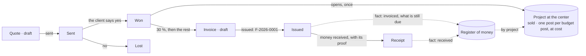

# Spec 001 — Sales

Step **G1** of the plan (`docs/ROADMAP.md`): quotes with their cost, invoices numbered without a
gap, money received — and a won quote that opens its project at the center with its budget.

## Why

A small company writes its quotes in a spreadsheet, its invoices in a word processor, and learns
what it earned on a job when the year closes. Three things are lost on the way: what the job was
expected to cost (so nobody knows what it may spend), what is sold and not invoiced yet, and
which money in the bank belongs to which job (doctrine D-049).

## What it gives

- **A quote** has its client, its lines and its tax. Each line says its price, **what it costs**
  and its **budget post** (« Matériel », « Main-d'œuvre »). Its totals, its cost and its margin
  are computed by `@kete/money`, each line rounded once. It is numbered at once (`D-2026-0001`).
  A draft is rewritten; once sent it is what the client read.
- **Won**, a quote opens its **project at the center**: its name, its client, the amount sold,
  and one post per budget post of its lines — at their cost, two lines on one post added up.
  Asked twice, the center answers the same project (`bornFrom`).
- **An invoice** is prepared from a won quote — a share in percent: a deposit, a stage, what is
  left — or without a quote. The invoices of a quote add up to it **to the unit**: the one that
  takes the rest takes the rest of the tax too. Nothing is invoiced beyond the quote.
- **Issued**, an invoice takes the next number of the year (`F-2026-0001`, `@kete/sequences`):
  no gap, no number twice — a draft thrown away never took one. From there it is never changed
  nor deleted.
- **Money received** is recorded on an issued invoice with its day, its method and its proof (a
  transfer's reference, a cheque's number) — never beyond what is due.
- **The register of money** holds each fact once, under its key: an invoice says what is still
  due on it, a receipt what came in — both with their project. The center is told after each
  gesture, in the contract's shape (`money-fact.v1`).
- **Three permissions, three roles**: who sells writes quotes and prepares invoices
  (`sales:write`); who keeps the accounts issues them (`sales:issue`); who holds the till records
  the money (`sales:collect`). An agent reads and prepares; issuing and recording money wait for a
  person, with her confirmation (level 4).
- **Screens**: « Ventes » — what is offered, what is won and waits for its invoice, what is
  invoiced and waits for its money; a quote and its invoices; an invoice and its receipts.

## When the center does not answer

The gesture is done anyway. A won quote waits for its project, a fact waits in the register; both
travel with the next gesture of someone the center accepts (she may open projects there, she may
record money there). An invoice issued before its quote's project existed moves to the project
when it opens, and its fact is told again with it. The home screen says how many facts wait.

## What stays for later

- A printable quote and invoice (letterhead, legal mentions), sent by e-mail, WhatsApp or
  Telegram; credit notes; a quote in several versions.
- A third party merged at the center: the quote keeps the identifier it was written with.
- The project as a right: who is not of a project still reads its documents if she reads sales.
- The facts travel with a person's token: someone the center refuses leaves them waiting. A
  delivery with the app's own token, by the worker, is not built.
- Value-added tax owed to the state; several currencies in one deployment.

## Proof

- `tests/sales.test.ts` (20): **a won quote becomes a project with its budget** — written by who
  sells, numbered, opened at the center with its client, the amount sold and one post per budget
  post at cost, once; totals, cost and margin to the unit; invoices that add up to their quote;
  numbers without a gap; money never beyond what is due; who sells does not issue, who issues
  does not hold the till, a member without a role reads nothing; an agent prepares and never
  issues; a center that is away or that refuses leaves nothing lost; a project opened late takes
  what was already invoiced; each organization's rows to itself (RLS); the manifest.
- `tests/complete.test.ts` (7): the template's own proofs, on sales.
- Seen in the demonstration (`pnpm demo`): the home's four figures, a won quote with its
  invoices, a quote written on the screen and numbered `D-2026-0005`.
- Not seen: the project opening at a real Kete Enterprise — the demonstration runs without a
  center; the test plays the center's answers.
