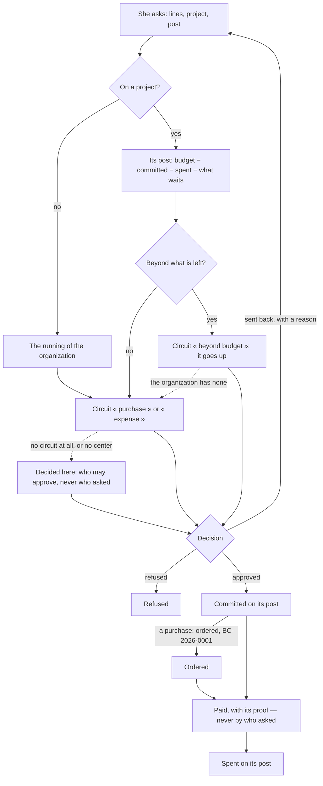

# Spec 002 — Purchases and expenses

Step **G2** of the plan (`docs/ROADMAP.md`): purchase requests with their project and their post,
expense notes, advances to justify, the memory of prices — and a request that goes beyond its post
going up the circuit.

## Why

A budget written at the start of a job is forgotten the day the first purchase is made: nobody
knows, when a request arrives, what its post still has. The overrun is found at the end, when it
can no longer be decided. And in a small company the same person asks, approves and pays — which
is how money is lost without anyone stealing it (doctrine D-049).

## What it gives

- **A purchase request** says what is to be bought (lines with quantity and unit price), from whom
  when it is known, and — when it is for a project — **the project and the post of its budget**.
  She must belong to the project at the center. It is numbered at once (`DA-2026-0001`).
- **Where it stands against its post** is computed when she asks, and kept on the request: the
  post's budget (read at the center), less what is committed and spent on it (the register), less
  what is asked on it and still waits. What goes beyond is said in francs.
- **Who decides**: the center's circuits. A request within its post takes the circuit of its
  subject (`purchase`, `expense`); **a request beyond its post takes the circuit of
  `beyond_budget`** — the organization makes that one go higher. Its title at the center says by
  how much it goes beyond, and it carries its project, so a step may be the project lead's.
  Without a circuit for what goes beyond, the ordinary one; without any circuit, or without a
  center, the app's own rule: who holds `purchases:approve`, never who asked.
- **Sent back**, a request returns to who asked with the reason; she corrects it and it is decided
  again — at the center it is the same request, asked under the subject it was first asked under.
- **Approved**, a request commits its amount on its post: the register says what is still to pay.
- **A purchase is ordered** by who buys: it takes its order number (`BC-2026-0001`) and names its
  supplier.
- **A payment** is recorded with its day, its method and its proof — never more than what is owed,
  never by who asked. The register says what went out on the post, and what is still committed.
- **An expense note** is what a person already paid: its day, its proof, its lines. Approved, it
  is owed to her and paid like a purchase — or it **justifies an advance**.
- **An advance** is money given to a person to spend for the organization, with its proof. The
  register counts it as money out that has no post yet; each note that justifies it says its own
  expense on its own post and takes its amount off the advance — the same franc is never counted
  twice. What she did not spend is brought back; the advance is then settled.
- **The memory of prices**: typing a line recalls what the thing was last bought for, from whom
  and when — from approved requests only.
- **Five permissions**: ask (`purchases:ask`, anyone with a role of the trade), read everyone's
  (`purchases:read`), decide here (`purchases:approve`), order (`purchases:order`), pay and give
  advances (`purchases:pay`). An agent reads, recalls prices and prepares a request; paying needs
  a person's confirmation (level 4).
- **Screens** under `/achats`: what waits for a decision, for an order, for a payment; a request
  with its standing, its decision and its payments; advances.

## How the center's decision comes back

The center posts the request's id to `/api/centre/decisions`. Nothing in that message is
believed: the app reads the decision at the center with its own token (`kete:center`) and applies
what it read. A request that still waits is read again when someone opens it.

## What stays for later

- An expense note read from a photo of its receipt (kete-core step E4), and the receipt kept as a
  file: today the proof is a reference typed by hand.
- Goods received, and a supplier's invoice checked against the order and what was received.
- The center's directory as a list: an advance outside a project is given to someone this app
  already knows.
- A request that was approved and is cancelled; a payment undone.
- A purchase that the center's circuit decided while its callback could not be reached, and that
  nobody opens: a worker that reads the waiting decisions is not built.

## Proof

- `tests/purchases.test.ts` (19): **a request beyond its post goes up the circuit** — 1 530 000 of
  budget, 120 000 committed, 1 500 000 asked: 90 000 beyond, sent to `beyond_budget` with its
  project and the post in its title; what is asked and waits counts; sent back, corrected by who
  asked and decided as the same request; the ordinary circuit when the organization has none for
  what goes beyond; who is not of the project asks nothing on it. Around it: without a circuit the
  owner decides, never who asked; ordering and paying are each someone else's; an advance is
  given, justified on its post and settled to the unit; the register adds up post by post; the
  memory of prices; who reads what; RLS; the manifest's subjects.
- Seen in the demonstration (`pnpm demo`): the home of purchases, a request waiting to be decided
  here, a request sent back with its reason, an advance partly justified.
- Not seen: a request on a project — the demonstration runs without a center, where projects
  live; the test plays the center.
