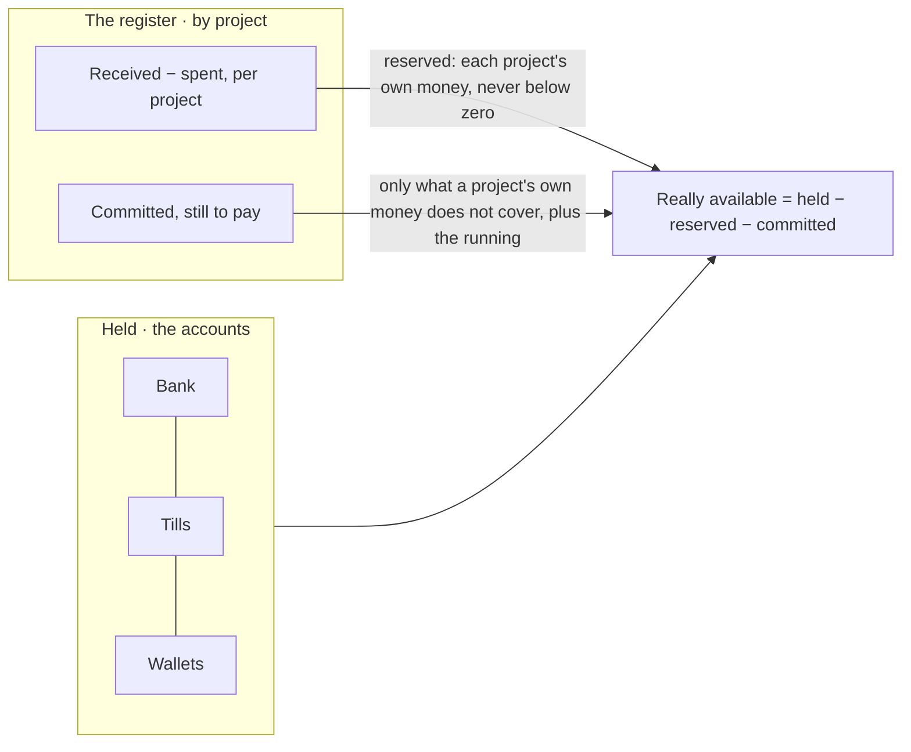

# Spec 003 — Treasury

Step **G3** of the plan (`docs/ROADMAP.md`): accounts and their movements, the three states of
money, the funds of each project, and a till closed every day.

## Why

« How much do we have? » has three answers, and a company that knows only the first one spends
money that is not its own. What is in the bank includes the deposit a client paid for a job that
has not bought its panels yet, and does not show the purchases already approved. And when several
jobs share one account, a late client is hidden by another's deposit — until both jobs need the
same franc (doctrine D-049).

## What it gives

- **Accounts**: a bank account, a till, a mobile wallet, each opened with what it holds that day.
- **Money lands on its account with the gesture that moves it**: a receipt, a payment, an advance
  given or brought back write their movement in the same transaction — cash to the till, a
  transfer or a cheque to the bank, mobile money to the wallet. With no account of that kind the
  movement **waits to be assigned** and is in no balance meanwhile; the gesture is not stopped.
- **The three states of money**, computed here and nowhere else:
  - **held** — what the accounts hold;
  - **reserved for projects** — what each project received and has not spent: its own money,
    never below zero;
  - **committed** — what is approved and still to pay that no project's own money covers, plus
    what the running of the organization owes;
  - **really available = held − reserved − committed**. A project's commitments are paid with its
    own money first, so no franc is taken off twice.
- **The funds of each project**: received, spent, available, committed — and what it says of
  itself: covered by its own funds, committed beyond them, or **spending the money of others**
  when it spent more than it received.
- **A till closed every day**: who holds it counts the drawer; the closing writes what the
  movements expected, what was counted and the difference — as it is, with a word. From then on
  the till takes nothing dated that day or before: a receipt is refused, not lost.
- **Nothing leaves a till or a wallet that is not in it**; a bank account may be overdrawn.
- **Money carried between accounts** (the till's cash taken to the bank), and **other movements**
  (bank fees, a contribution) by who keeps the accounts.
- **Three permissions**: read (`treasury:read`), keep the accounts (`treasury:manage`), close a
  till (`treasury:close`) — who keeps the accounts does not close the till. An agent reads where
  the money stands, every figure computed here; it moves nothing.
- **Screens** under `/tresorerie`: the four figures, the accounts, the movements to assign, the
  funds by project; an account with its movements, its closings, its forms.

## What stays for later

- A bank statement read and matched against the movements (reconciliation); kete-core's step E4
  gives the reading.
- Choosing the account on a receipt's or a payment's form when there are two of a kind: today the
  first one takes it, and who keeps the accounts moves it.
- A closing's difference decided: written off, or owed by who held the till.
- Other movements are not facts of the register: bank fees lower what is held, and count in no
  project nor in the running.
- A forecast: what is expected in (invoices due) and out (what is committed) by date.
- Two gestures paying from one till at the same instant are not serialized.

## Proof

- `tests/treasury.test.ts` (12): **« really available » is the bank less reserved and committed**
  — 2 050 000 held; a project receives 600 000: 2 650 000 held, still 2 050 000 available; its
  purchase of 250 000 is committed then paid from its own money: still 2 050 000; the running
  owes 40 000: 2 010 000; a project that received nothing commits 300 000: 1 710 000, and once
  paid it is said to have spent 300 000 of the money of others. Around it: a mobile payment
  waiting for its account, money carried between accounts, a till that lets nothing leave that is
  not in it, a closing 500 short written as it is, a receipt refused on a closed day and taken
  the next, who may read and who may not, RLS.
- All four files: 58 passed.
- Seen in the demonstration (`pnpm demo`): the four figures, three accounts, a closing with its
  difference.
- Not seen: funds by project — the demonstration runs without a center, so nothing carries a
  project there.
