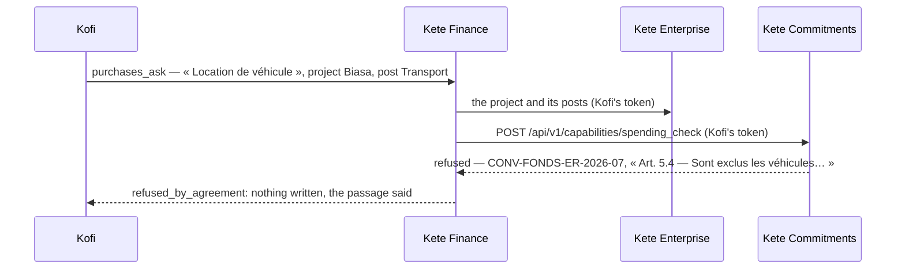

# Spec 004 — A funder's rules, before money is committed

Kete Finance's side of step **I1** (Kete Enterprise's roadmap): « A funder's clause refuses a
purchase ». The agreements and their rules live in Kete Commitments; Kete Finance asks before it
writes a request on a funded project.

## What changes

- A request on a project is checked against its funders' rules **before it is written**:
  `spending_check` of Kete Commitments, at `COMMITMENTS_API_URL`, with the person's token — what
  the project, the post, the amount, the words of the request and the day are.
- **Refused**: the request is not written; the refusal names the agreement and cites its passage.
- **Allowed**: the request goes on to its circuit, and remembers it was allowed.
- **Not asked** — Kete Commitments is away, or does not let her ask: the request goes on and says
  so on its screen (`agreement: unchecked`), so who decides knows.
- Without `COMMITMENTS_API_URL`, nothing is asked; the running of the organization (no project)
  is never asked.

## What stays for later

- A ceiling per post over the whole agreement (Kete Commitments knows the rule, Kete Finance the
  amounts): today a ceiling is per expense.
- An expense refused that the funder may still allow by its prior opinion: asking it, and the
  answer coming back.
- Payments are not checked again: what was allowed when it was asked stays allowed.

## Proof

- `tests/agreements.test.ts` (4): asked with her token before anything is written; a vehicle is
  refused with the agreement and its passage, nothing written; written and marked when Kete
  Commitments is away; the running of the organization asks nothing.
- Kete Commitments' side: its `tests/commitments.test.ts` answers the same check over its API.
- All five files: 62 passed.
