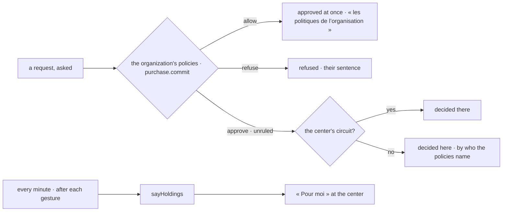

# Spec 005 — Kete Finance on the living model

Step **A5** of Kete's release (the doctrine's `FEUILLE_DE_ROUTE.md`; kete-core spec 114; Kete
Enterprise spec 091). The author's go came on 2026-10-17 (« Passe à A5 : les quatre apps du centre
sur le modèle unifié »).

## Why

What waits in Kete Finance — a quote on its client's answer, an invoice not yet paid, a request
sent back, an advance not justified — never reached « Pour moi » nor the relay when its holder is
away; a spending policy written at the center (« au-delà de 500 000 F, son responsable approuve »)
did not decide the requests made here.

## Requirements

- **FR-001 — A request through the policies.** Once asked, a purchase or an expense note is a
  `purchase.commit` on its project (or on its subject, `prd_kete_finance.purchase` / `.expense`),
  with its amount and what its post has left. `allow`: approved at once, decided by « les
  politiques de l’organisation »; `refuse`: refused with the policies' sentences; `approve` or
  `unruled`: it goes to the center's circuit as before, else is decided here — and the first person
  the policies name to approve it holds it (`approver_id`, migration 0012).
- **FR-002 — What Kete Finance holds**, said to the center after each gesture and every minute: a
  quote sent (held by who wrote it, waiting on its client when the center knows it, due on its
  validity); an issued invoice not fully paid (waiting on its client, due on its day); a request
  sent back (its requester's to correct); a request decided here (who the policies name, to
  approve); an approved purchase (its requester's to order); an advance not justified (its
  holder's). Each on its project when it has one, with its address here.
- Every word from the catalogs.

## Proof

- Tests: a note within the limit approved at once by the policies; one beyond it waiting on the
  manager they name, as her holding with its address; one above the ceiling refused with its
  sentence; a quote sent and every holding in the shape of `holding.v1`.

## Not done here

An approval asked by the policies opened as a card at the center when no circuit exists; the
sales' gestures (`invoice.issue` on an invoice issued here); the joined demonstration (G4).
