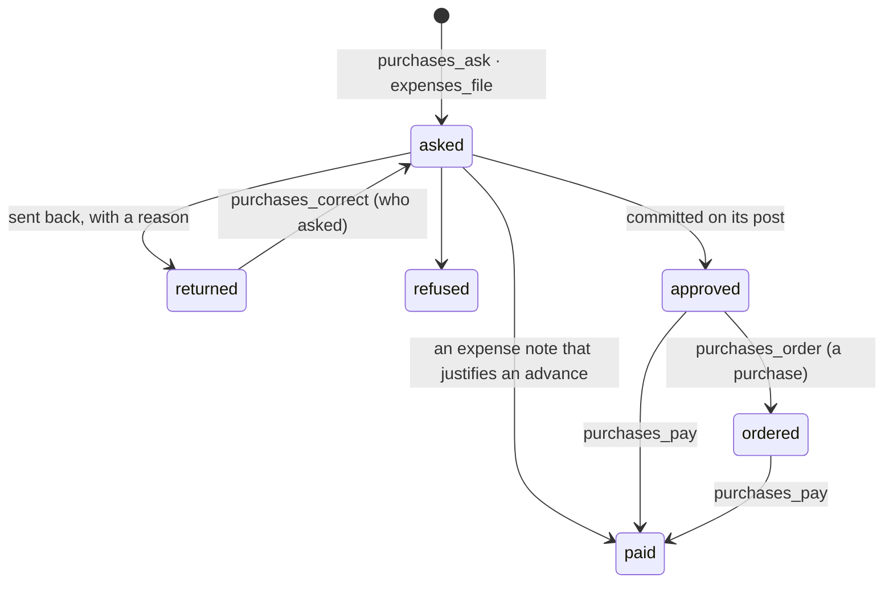

# Purchases and expenses

Purchase requests, expense notes, advances and the memory of prices (spec 002).

| File                                 | What it holds                                                                   |
| ------------------------------------ | ------------------------------------------------------------------------------- |
| `domain/purchases.ts`                | The rules: a request against its post, its subject, what is owed, an advance    |
| `domain/amount.ts`                   | A request's amount, alone: the server and the form share it                     |
| `purchase.record.ts`                 | The inputs and the shapes, described once (zod)                                 |
| `infrastructure/purchases.table.ts`  | The four tables with their row-level security, and every query                  |
| `commands/requests.ts`               | Ask, file, correct, decide here, settle (the center's decision), order, pay     |
| `commands/advances.ts`               | Give an advance, record what is brought back, and what the register says of it  |
| `projects.ts`                        | A project and its posts, read at the center with the person's token             |
| `route.ts`                           | After she asked: who decides; and the center's decision, read and applied       |
| `capabilities.ts`, `policies.ts`     | What each surface may call; the five permissions and the three subjects         |
| `functions.ts`, `ui/`                | The screens' server functions and components                                    |

## Rules worth knowing

- A request's standing is `budget − (committed + spent on the post) − (asked on the post and
  waiting)`, computed in the transaction that writes it. It is a snapshot: the request keeps what
  was true when she asked.
- `subjectOf` sends what goes beyond to `beyond_budget`, whatever it buys. A request sent back and
  corrected is asked again under the subject it was first asked under (`decision_subject`), so the
  center sees one request.
- `route` says who decides: `waiting` (not asked yet), `center`, or `here`. `purchases_decide`
  refuses a request the center decides (`decided_at_the_center`) and one's own (`own_request`).
- `settle` is the only place a decision is applied — from here or from the center.
- The register: `purchase:<id>` says what is still to pay (committed); `payment:<id>` what went
  out (spent); `expense:<id>` a note paid with an advance (spent); `advance:<id>` what its holder
  has neither justified nor brought back (spent, no post).
- The center is asked for a decision **after** the request commits, with the token of who asked
  (`routeWaiting`, from `platform/sync.ts`).

## The organization's policies (spec 005)

Once asked, a request is a `purchase.commit` the center's policies decide first (kete-core spec
114): allowed as it stands, it is approved at once by « les politiques de l’organisation »;
refused, it is refused with their sentences; to approve — or when no policy speaks of it — it goes
to the circuit, else is decided here, held by the first person the policies name
(`approver_id`). What purchases hold — a request sent back, one to approve here, a purchase to
order, an advance to justify — is said to the center as holdings (`purchaseHoldings`).

## A funder's rules (spec 004)

`agreements.ts` asks Kete Commitments (`spending_check`) before a request on a project is written, with the person's token. Refused: `refused_by_agreement`, with the agreement and its passage, and nothing is written. Not asked: the request goes on with `agreement = unchecked`.
