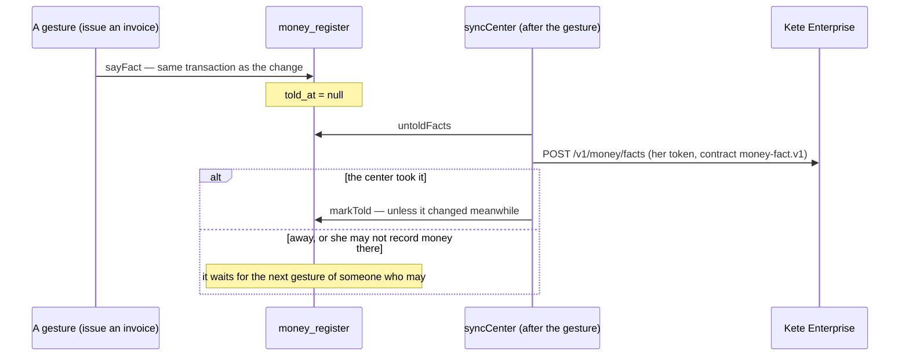

# The register of money

Every fact of money of the organization, once, under its key (doctrine D-049): what is invoiced
and still due, what was received, what is committed and still to pay, what was spent — each with
its project and its budget post, or without a project when it is the running of the organization.

- `sayFact(db, organizationId, fact)` writes or replaces a fact, in the caller's transaction.
- `dropFact(db, key)` takes one back: it stays, marked gone, and the center is told.
- `moveFacts(db, keys, projectId)` moves facts to a project that was just opened.
- `tellCenter(token, organizationId)` sends what the center has not heard; it never fails the
  gesture it follows.
- `listFacts`, `countUntold` read it.

A fact's key is the app's own: `invoice:<invoiceId>`, `receipt:<receiptId>`. Amounts are integers
of the currency's smallest unit, never negative.
