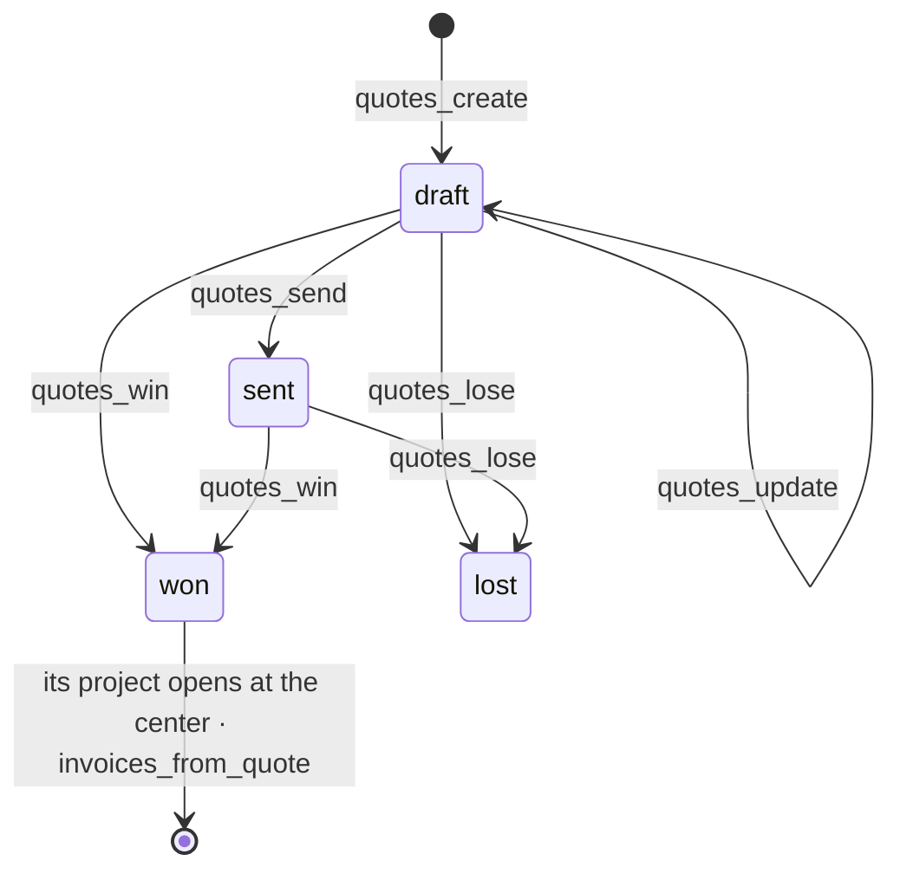

# Sales

Quotes, invoices and money received (spec 001).

| File                            | What it holds                                                                     |
| ------------------------------- | --------------------------------------------------------------------------------- |
| `domain/totals.ts`              | The arithmetic of a document, pure and light: the server and the form share it    |
| `domain/sales.ts`               | The rules: a quote's states, the part an invoice takes, what stays due            |
| `quote.record.ts`               | The inputs and the shapes, described once (zod)                                   |
| `infrastructure/sales.table.ts` | The five tables with their row-level security, and every query                    |
| `commands/quotes.ts`            | `create-quote`, `update-quote`, `send-quote`, `win-quote`, `lose-quote`           |
| `commands/invoices.ts`          | `invoice-quote`, `create-invoice`, `issue-invoice`, `discard-invoice`, `record-receipt` |
| `projects.ts`                   | `openWonProjects`: asks the center for the project of each won quote, once        |
| `capabilities.ts`               | What a screen, a copilot and an agent may call, and how far alone                 |
| `policies.ts`                   | `sales:read`, `sales:write`, `sales:issue`, `sales:collect`                       |
| `functions.ts`, `ui/`           | The screens' server functions and components                                      |

## Rules worth knowing

- A line's amount is `quantity × unit price`, rounded once; the tax is computed once, on the
  subtotal. Cost and margin are before tax.
- A project's budget is the **cost** of the quote's lines by post — what the job may spend — and
  its amount sold is the quote's total.
- `partOf` gives the last invoice of a quote what is left, tax included: the invoices add up to
  the quote to the unit.
- An invoice's number is taken in the transaction that issues it (`nextNumber`): a failed issue
  consumes none.
- The register says of an invoice what is **still due** (`invoice:<id>`), and of each receipt
  what came in (`receipt:<id>`).
- `attach-project` is run by the app when the center answers, never by a hand: it moves the
  quote's invoices and their facts to the project.
