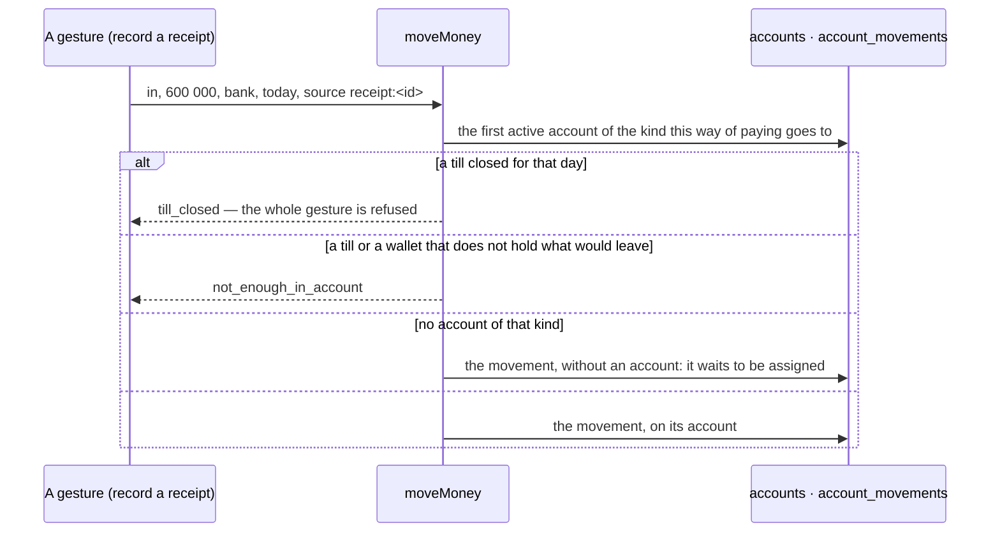

# Treasury

Accounts, their movements, the three states of money and the tills' closings (spec 003).

| File                               | What it holds                                                               |
| ---------------------------------- | --------------------------------------------------------------------------- |
| `domain/standing.ts`               | The three states of money and a project's funds — pure, the only arithmetic |
| `domain/treasury.ts`, `kinds.ts`   | The rules: what leaves a till, where a way of paying goes                   |
| `treasury.record.ts`               | The inputs and the shapes, described once (zod)                             |
| `infrastructure/treasury.table.ts` | The three tables with their row-level security, `moveMoney`, every query    |
| `standing.ts`                      | `treasuryStanding`: held from the accounts, the rest from the register      |
| `commands/treasury.ts`             | Open an account, record a movement, carry money, assign, close a till       |
| `capabilities.ts`, `policies.ts`   | What each surface may call; the three permissions                           |
| `functions.ts`, `ui/`              | The screens' server functions and labels                                    |

## Rules worth knowing

- `moveMoney` is called by the commands of sales and purchases, in their transaction: the receipt
  and its movement commit or roll back together. Its `source` is unique: a movement is written
  once.
- An account's balance is its opening plus its movements; nothing stores it.
- `reallyAvailable(held, projects, runningCommitted)`: `reserved = Σ max(0, received − spent)`;
  `committed = Σ max(0, committed − reserved) + runningCommitted`.
- A closing is never changed: `difference = counted − expected` is checked by the table itself.
- A movement that waits for its account is in nobody's balance: « really available » is lower by
  as much until it is assigned — the figure errs on the careful side.
